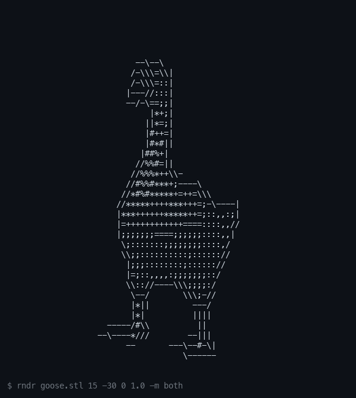

# rndr

<p align="center">
  
</p>

[](https://github.com/ryanjjohnson/rndr/actions/workflows/release.yml)
[](https://github.com/ryanjjohnson/rndr/actions/workflows/security.yml)
[](https://github.com/ryanjjohnson/rndr/releases/latest)
[](LICENSE)
[](#the-prompt)

ASCII previewer for 3D models in the terminal: STL, OBJ and 3MF.

One static binary with no dependencies: no runtime to install, no external programs.
Written in Go using only the standard library.

## The Prompt

*Translated from grunts and sneers*

This program was written by Claude from a single request. Tidied up, it read:

> Build a console application that reads an STL file and renders it as ASCII art in the
> terminal, using as few external tools as possible.
>
> **Rendering**
> - Wireframe is the requirement; shading would be a welcome addition.
>
> **Interactive use:** `rndr [filename]`
> - Rotate with `W` `A` `S` `D`.
> - Pan with `Shift` + `W` `A` `S` `D`.
> - Zoom in and out with `i` and `o`.
> - Save the view exactly as currently framed (whatever the rotation, pan and zoom happen
>   to be) to a text file.
>
> **Non-interactive use:** `rndr somefile.stl 94 0 0 1.0`
> - The arguments are the X, Y and Z rotation followed by the zoom factor.
> - Print the render to stdout.
> - The exact argument format is flexible; do whatever makes sense.
>
> **Purpose:** previewing STL files from the command line while browsing a NAS.

The original asked for zsh. That lasted about four seconds before being amended to
"something very portable", which became Java and then, so that it could be shared with
people whose NAS has no Java, Go. OBJ and 3MF support, width-only sizing, the release
pipeline and this section were follow-up requests in the same conversation.

## Install

Download the binary for your platform from the
[latest release](https://github.com/ryanjjohnson/rndr/releases/latest), put it somewhere on
your PATH and name it `rndr` (on Mac and Linux, also `chmod +x rndr`):

| Machine | File |
|---|---|
| Mac (Apple silicon / Intel) | `rndr-darwin-arm64` / `rndr-darwin-amd64` |
| Linux or NAS, Intel/AMD | `rndr-linux-amd64` |
| Linux or NAS, 64-bit ARM | `rndr-linux-arm64` |
| Linux or NAS, 32-bit ARM | `rndr-linux-armv7` |
| Windows | `rndr-windows-amd64.exe` |

On a Mac, a downloaded binary is quarantined; clear that with
`xattr -d com.apple.quarantine rndr`, or build from source.

## Build

```bash
sh build.sh
```

```bash
sh build.sh release
```

The first builds `./rndr` for this machine; the second cross-compiles every platform into `dist/`.
Needs Go 1.21 or later.

Every push to `main` that changes the program publishes a new release automatically, bumping
the patch version. To choose the version yourself, push a tag such as `v0.2.0`.
The `security` workflow runs `govulncheck` and CodeQL on every push and once a week.

## Use

```
rndr part.stl                     interactive viewer
rndr part.3mf 94 0 0 1.0          print one frame: RX RY RZ [ZOOM [PANX PANY]]
rndr part.obj -p                  print the default view
rndr part.stl 25 -30 0 -s 100x40 -m wire -o part.txt
rndr part.stl -p -s 100           100 columns wide, as many rows as the model needs
cat part.stl | rndr - -p
```

`rndr --help` lists every option. Rotation is tilt (X), spin (Y), roll (Z) in degrees;
`0 0 0` is the front view with model Z up. Zoom 1.0 fits the whole model.

Interactive keys: `w/s` tilt, `a/d` spin, `z/x` roll, `W/A/S/D` pan, `i/o` zoom,
`m` cycle mode, `r` reset, `p` save the frame, `?` help, `q` quit.

`p` writes `NAME.rndr.txt` into the current directory (the temp dir if that is read-only).
The status bar always shows the `view` numbers that reproduce the current frame from the
command line.

Modes: `both` (shading + feature edges), `wire` (feature edges and silhouette, hidden lines
removed), `mesh` (every triangle edge), `xray` (see-through mesh), `shade`.

Print mode sizes the frame from `-s`, then `FZF_PREVIEW_COLUMNS/LINES`, then the terminal,
then 80x24, so it works as a file-manager previewer:

```bash
fzf --preview 'rndr {} -p'
```

## Formats

- **STL**: binary and ASCII.
- **OBJ**: vertices and faces; polygons are triangulated; materials and textures are ignored.
- **3MF**: the whole build plate, including assemblies, per-item transforms and meshes kept
  in separate parts (as Bambu Studio, OrcaSlicer and PrusaSlicer write them). Colours and
  materials are ignored.

## Layout

- `main.go`: command line and the interactive loop
- `formats.go`: STL, OBJ and 3MF readers
- `mesh.go`: vertex welding, normals, edge detection
- `render.go`: projection, rasteriser, edge drawing, shading
- `term_*.go`: raw keyboard input and terminal size per operating system
- `docs/`: the animation above and `make-demo.py`, the script that regenerates it
- `testdata/`: a small model and its expected render, used by the release smoke test
- `java/`: the original Java version, kept for reference

## Licence

MIT. See [LICENSE](LICENSE).
